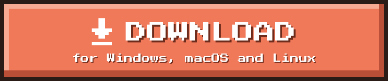
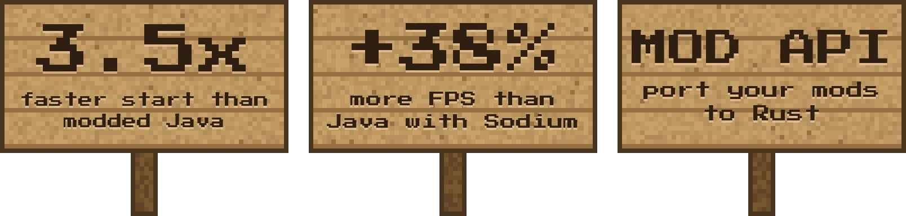

# Horizon RTX + VR (Thib1404's fork)

> **This is not the official Horizon.** It is a fork of [horizon-rust/horizon](https://github.com/horizon-rust/horizon) by
> Thib1404, with a hardware ray-traced renderer, VR for the Apple Vision Pro and sound physics. The official project,
> its downloads, its Discord and its support are upstream: the sections below this one are upstream's README, kept as
> they are. Nothing here is endorsed by Horizon's maintainers.

**What it adds** (all off by default, so with default settings the game draws as upstream does):

- **Ray-traced lighting** (`rtLighting`, `linearLight`, `rayTracedShadows`, `rayTracedAo`, and the `rtx` build
  feature for the raw Vulkan parts): sun and moon shadows, AO, ReSTIR GI, reflections, a ReLAX denoiser, a radiance
  cache, a physical sky with real stars, the moon and the planets, volumetric fog and clouds, LabPBR materials and
  parallax, rain and snow, wind. See [docs/raytracing.md](docs/raytracing.md).
- **VR** (`vr:true` in `horizon-graphics.txt`, or `HORIZON_XR=1`): OpenXR stereo with both eyes sharing the ray
  tracing, foveated rendering, gaze aiming. See [docs/vr.md](docs/vr.md).
- **Sound physics**: occlusion, reverb from the rooms around the player, binaural sound and Doppler.

**Built for an RTX 4090, for now.** It was written and tuned on an RTX 4090 (Windows, Vulkan), on a monitor and in
VR at 4400x3520 per eye. Other GPUs will run it slower, and some parts need hardware ray tracing. It hasn't been
optimised for them yet. The measurements are in [docs/rtx-4090.md](docs/rtx-4090.md).

**Made with AI.** The code was written by AI agents (Claude Code, with Claude Fable 5.2 and Claude Opus 5.5), directed
and play-tested by Thib1404.

**Relation to upstream.** The whole fork was offered to Horizon in one block in
[horizon-rust/horizon#16545](https://github.com/horizon-rust/horizon/pull/16545), which says openly that it breaks
the project's rules on size and specs. Upstream's own ray tracing plan (#13780, #15624, #16011) gives the look to
shader packs instead, so the parts upstream wants will go there as small pull requests, and the rest stays here.
This branch is the same code as that pull request: DLSS Ray Reconstruction (NVIDIA's SDK can't be published) and the
copper projector mod are left out.

**Build:** `cargo build --profile fast -p horizon-client --features rtx`. You need your own Minecraft: Java Edition
install, as for upstream Horizon (see [CONTRIBUTING.md](CONTRIBUTING.md)).

**Licence:** the same as upstream Horizon, the [GNU LGPL, version 3 or later](LICENSE), for the fork's additions too.
Code from before upstream's move away from MIT stays available under the [MIT licence](LICENSES/MIT.txt).
Dependencies and bundled assets keep their own licences ([notices](THIRD_PARTY_NOTICES.md)).

---

  <picture>
    <source media="(prefers-color-scheme: dark)" srcset="docs/media/readme/title-dark.png">
    
  </picture>

  <b>Minecraft: Java Edition 26.3, rewritten from scratch in Rust.</b> 
  It opens your worlds, generates the same terrain and plays by the same rules, without Java.

   
  You need your own copy of Minecraft: Java Edition.

  <a href="https://playhorizon.dev/docs/install"><b>Install guide</b></a> ·
  <a href="https://playhorizon.dev/docs/"><b>Docs</b></a> ·
  <a href="https://playhorizon.dev/mods"><b>Mods</b></a> ·
  <a href="https://discord.gg/playhorizon"><b>Discord</b></a>

  

  

  Against Java Edition with Sodium, Lithium, FerriteCore and ImmediatelyFast on a Ryzen 7 9800X3D with an RTX 5080. More computers on the <a href="https://playhorizon.dev/benchmarks">benchmarks page</a>.

<h2 align="center">What you get</h2>

- **Vanilla Minecraft:** survival, creative and hardcore in every dimension, with the same terrain, mobs, villagers and redstone. Your saves open as they are.
- **Multiplayer:** vanilla and Horizon servers, LAN, and invite codes for playing your world with friends. You can [host a server](https://playhorizon.dev/docs/hosting) too.
- **Mods:** Horizon's own mod system, with mods like zoom and a minimap, and shader packs. Browse the [catalogue](https://playhorizon.dev/mods) or [make a mod](https://playhorizon.dev/docs/make-a-mod).
- **Beyond vanilla:** terrain up to 1,024 chunks away, HDR, controller support, graphics presets and dynamic lights.

<h2 align="center">What you need</h2>

- **Your own copy of Minecraft: Java Edition.** Horizon ships no Minecraft files. It builds them from the game you bought, so install version 26.3 and start it once.
- **Windows, macOS or Linux:** Windows on x64 or ARM64, macOS 12 or later, Linux on x86-64.

<h2 align="center">Made by the Horizon Team</h2>

<table align="center">
  <tr>
    <td align="center" width="140"><a href="https://github.com/kacpherek"> <b>Kacper</b></a></td>
    <td align="center" width="140"><a href="https://github.com/Online5277"> <b>Cosmic</b></a></td>
    <td align="center" width="140"><a href="https://github.com/levzzz5154"> <b>levzzz</b></a></td>
    <td align="center" width="140"><a href="https://github.com/rdbtCVS"> <b>rdbt</b></a></td>
    <td align="center" width="140"><a href="https://github.com/dezer-x"> <b>Anthony S</b></a></td>
    <td align="center" width="140"><a href="https://github.com/ludovic111"> <b>Ludovic Marie</b></a> Founder</td>
  </tr>
</table>

  and everyone who has contributed  
  

  <a href="docs/native-client.md#run-from-a-checkout"><b>Build guide</b></a> ·
  <a href="CONTRIBUTING.md"><b>Contributing</b></a> ·
  <a href="GOVERNANCE.md"><b>Governance</b></a> ·
  <a href="https://github.com/sponsors/ludovic111"><b>Sponsor</b></a>

Horizon is released under the [GNU LGPL, version 3 or later](LICENSE), for the project's original work. Code merged before the move from MIT stays available under the [MIT licence](LICENSES/MIT.txt). Dependencies keep their own licences, see the [notices](THIRD_PARTY_NOTICES.md). Founded by [Ludovic Marie](https://lu4ovic.com) and built by the Horizon Team and [its contributors](https://github.com/horizon-rust/horizon/graphs/contributors). You can support it on [GitHub Sponsors](https://github.com/sponsors/ludovic111).

NOT AN OFFICIAL MINECRAFT PRODUCT. NOT APPROVED BY OR ASSOCIATED WITH MOJANG OR MICROSOFT. Minecraft is a trademark of Mojang Synergies AB; its code and assets belong to Mojang and Microsoft under the [Minecraft EULA](https://www.minecraft.net/en-us/eula).
